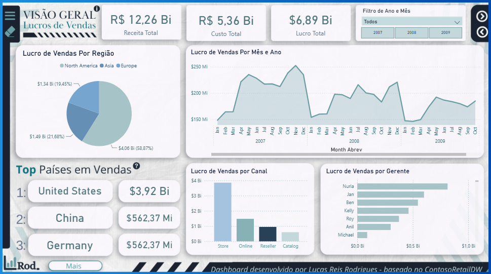
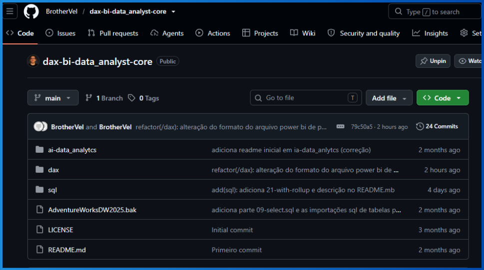

# Sobre mim

<table>

Sou um analista de dados e desenvolvo projetos pessoais focados em transformar dados em insights. desenvolvo dashboards, consultas e análises que permitem identificar padrões, tendências e oportunidades de melhoria.

Busco ir além da apresentação de números, compreendendo o contexto dos dados e traduzindo informações em análises claras, estruturadas e úteis.

Entre os meus focos nos repositórios estão:

</Table>

<table>

</Table>

<h2 align="center">📂 Projetos em destaque</h2>

<table>
  <tr>
    <td width="50%" style="vertical-align: top;">
      <a href="https://github.com/BrotherVel/Dashboard-sales-ContosoRetailDW">
        
        <h3 align="center">Dashboard Sales ContosoRetail DW</h3>
      </a>
      

        Um projeto de portifólio de análise de um cenário excêntrico de vendas entre 2007 e 2009 baseado no banco de dados ContosoRetailDW da Microsoft.
      

      

        
        
        
        
      

    </td>
    <td width="50%">
      <a href="https://github.com/BrotherVel/dax-bi-data_analyst-core">
        
        <h3 align="center">Data Analyst Core</h3>
      </a>
      

        Repositório dedicado ao estudo de SQL, DAX, Power Query e Power BI, reunindo exemplos práticos e materiais de apoio para desenvolvimento e análise de dados.
      

      

        
        
        
        
        
        
        
        
        
        
      

    </td>
  </tr>
</table>

## 📫 Contato

